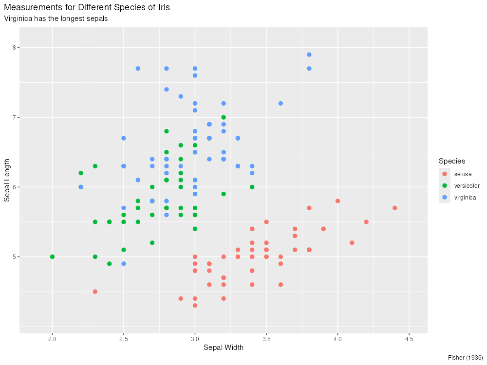

```{r}
#| echo: false
library(ggplot2)

iris_plot <- ggplot(
  iris,
  aes(x = Sepal.Width, y = Sepal.Length, color = Species)
) +
  geom_point(size = 2.5) +
  scale_color_manual(
    name = "Species",
    breaks = c("setosa", "versicolor", "virginica"),
    values = c(
      setosa = "#F8766D",
      versicolor = "#00BA38",
      virginica = "#619CFF"
    )
  ) +
  scale_x_continuous(
    limits = c(1.9, 4.5),
    breaks = seq(2.0, 4.5, by = 0.5)
  ) +
  scale_y_continuous(
    limits = c(4.1, 8.1),
    breaks = 5:8
  ) +
  labs(
    title = "Measurements for Different Species of Iris",
    subtitle = "Virginica has the longest sepals",
    x = "Sepal Width",
    y = "Sepal Length",
    caption = "Fisher (1936)"
  ) +
  theme_gray() +
  theme(
    plot.title.position = "plot",
    plot.caption.position = "plot",
    plot.title = element_text(hjust = 0),
    plot.subtitle = element_text(hjust = 0),
    plot.caption = element_text(hjust = 1),
    legend.position = "right"
  )

ggsave(
  filename = "iris_scatterplot.png",
  plot = iris_plot,
  width = 10,
  height = 7.5,
  units = "in",
  dpi = 100
)


```